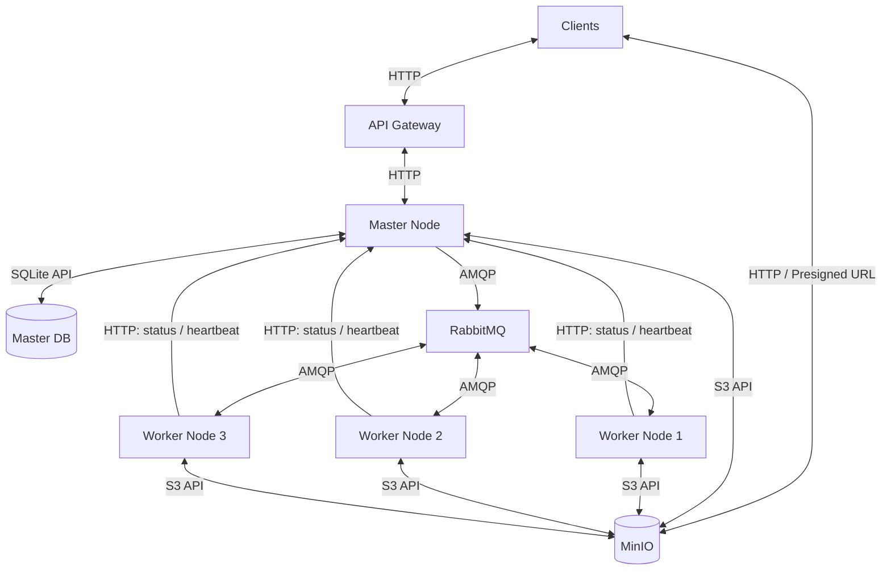

# Техническое решение проекта «Лазарь»

## Введение
«Лазарь» — программа обработки изображений с распределённой архитектурой, предназначенная для преобразования графических файлов и их анализа на наличие космических объектов. Анализ выполняется на основе характеристик яркости и геометрической формы областей на изображениях в форматах PNG и JPEG. «Лазарь» позволяет приблизительно определить кометы, планеты, галактики и звездные поля; в случае, если визуальных признаков не достаточно для определениия типа объекта, система относит его к категории неопределенных объектов. 
По окончании анализа пользователь получит обработанное изображение с выделенными и подписанными обнаруженными космическими объектамаи, а также текстовый отчет с предполагаемыми типами объектов и их характеристиками.

- **Цель проекта:**  
  Реализовать прототип распределённой системы, позволяющей пользователям загружать изображения для их автоматического анализа на распределенном вычислительном кластере.

- **Основания для разработки:**  
  1. Закрепить теоретические основы распределенных систем (маштабируемость, отказоустойчивость, консистентность) на практике
  2. Учебный проект по курсу «Распределенные системы»

- **Команда:**  

  | ФИО участника    | Роль в проекте    |
  |------------------|-------------------|
  | Богомаз Алиса    | DevOps, Team Lead |
  | Михайлов Дмитрий | System Analyst    |
  | Давыдова Дарья   | UX Designer       |

---

## Глоссарий
| Термин        | Определение |
|---------------|-------------|
| Пользователь  | Лицо, взаимодействующее с системой через приложение |
| Графический файл | Изображение |
| Приложение | Программа для настройки и анализа изображений |
| Распределенный кластер | Совокупность вычислительных узлов, совместно выполняющих обработку изображения|
|Worker-узел| Вычислительный узел системы, выполняющий непосредственную обработку и анализ фрагментов изображений|
|Идемпотентность|Свойство, при котором повторное выполнение одной задачи не меняет итоговый результат операции|
|Консистентность|Свойство, гарантирующее согласованность состояний задач и результатов обработки |
|Presigned URL|Временная ссылка, предоставляющая ограниченный доступ к объекту в хранилище без передачи учетных данных|
|S3 API|Интерфейс взаимодействия с объектным хранилищем|
|API Gateway|Компонент системы, принимающий и перенаправляющий запросы клиентов|
|Master Node|Управляющий узел, координирующий создание, распределение и выполнение задач|
|Worker Node |Вычислительный узел, выполняющий обработку назначенных фрагментов изображений|
|SQLite|База данных для хранения состояний заданий и метаданных|
|RabbitMQ|Брокер сообщений, обеспечивающий передачу заданий вычислительным узлам|
|MinIO|Объектное хранилище исходных изображений и результатов обработки|
|HTTP|Протокол передачи данных между клиентами и компонентами системы|
|AMQP|Протокол обмена сообщениями между RabbitMQ и компонентами системы|
|Heartbeat|Периодический сигнал для контроля доступности вычислительного узла|
|TImeout|Интервал ожидания, по истечении которого система предполагает сбой|
|ACK|Подтверждение обработки сообщения, отправляемого Worker брокеру RabbitMQ|
|Retry|Повторная попытка выполнения задания после ошибки или сбоя|

---

## Функциональные требования
- **Система должна предоставлять следующие функции:**
1. Загрузка исходного изображения и возможность заменить его на другое до запуска обработки
2. Отображение загруженного изображения на экран для предварительного просмотра
3. Настройка яркости, контрастности, масштаба и степени шумоподавления выбранного изображения
4. Отображение измененного пользователем изображения до запуска обработки
5. Автоматический анализ изображения с выбранными параметрами и последующим определением его содержимого: комета, планета, галактика, звездное поле или неопределенный тип объекта
6. Отображение состояния выполнения задачи
7. Возможность просмотра результатов анализа только по окончании обработки графического файла
8. Просмотр обработанного файла и результатов анализа в виде выделенных рамками и подписанных предположительными типами объектов на изображении
9. Составление текстового отчета по результатам обработки с указанием предположительных типов объектов, их количества и их параметров (яркость, геометрическая форма, координаты)
10. Возможность сохранить полученное обработанное изображение и текстовый отчет на устройство пользователя
11. Возможность изменить изображение и его параметры и повторить анализ в случае неуспешной или не возможной обработки системой файла

- **Ограничения на предметную область:**
1. Система предназначена для обработки и анализа растровых изображений космического пространства в форматах JPEG и PNG
2. Определение типов космических объектов, отличающихся от планет, комет, галактик и звездных полей не предусматривается
3. Система ориентирована на анализ изображений, содержащих один или несколько визуально различимых объектов, либо множества ярких областей, образующих звездное поле
4. Результаты анализа являются предварительными и не предназначены для научных исследований

---

## Нефункциональные требования
- **Масштабируемость:** возможность увеличивать число Worker-узлов без изменения логики
- **Отказоустойчивость:** при падении одного из Worker-узлов система должна обнаружить его недоступность и передать его задачи на выполнение в очередь для других Worker-узлов
- **Параллельность:** система должна обеспечивать параллельное выполнение независимых задач несколькими узлами
- **Консистентность:** система должна обеспечивать согласованность состояний задач и результатов обработки между узлами
- **Балансировка нагрузки:** система должна динамически распределять задачи между доступными Worker-узлами с учетом их загруженности
- **Идемпотентность:** повторное выполнение одной задачи не должно влиять на итоговый результат обработки изображения

---

## Пользовательские сценарии
Сценарий: загрузка исходного изображения
1.	Пользователь запускает приложение 
2.	Пользователь выбирает функцию загрузки изображения и загружает графический файл 
3.	Система проверяет формат файла и отображает его превью на экране

Сценарий: загрузка другого изображения
1.  Пользователь загружает другой графический файл через функцию выбора другого изображения 
2.	Система проверяет формат файла и обновляет превью, отображая на экран новое изображение

Сценарий: настройка параметров и запуск анализа
1.	Пользователь настраивает визуальные параметры для обработки фотографии: 
    1. Изменение контраста и яркости 
    2. Подавление цифрового шума на снимке 
    3. Масштабирование 
2.	Пользователь выбирает функцию запуска обработки
3.	Система подтверждает приём файла, сохраняет настройки и начинает обработку

Сценарий: получение и просмотр результата 
1.	Пользователь запрашивает результат обработки
2.	Система выводит обработанное изображение с найденными космическими объектами и текстовый отчет с результатами

Сценарий: файл поврежден или не подходит для обработки
1. Пользователь запускает приложение
2. Пользователь загружает поврежденный или неподдерживаемый для обработки файл через функцию загрузки изображения
3. Система проверяет формат файла и обнаруживает несоответствие требованиям
4. Система выводит на экран сообщение об ошибке
5. Система предоставляет пользователю возможность выбрать другой графический файл для анализа

Сценарий: космические объекты не были обнаружены
  1. Пользователь загружает изображение
  2. Система проверяет формат файла и отображает его превью на экране
  3. Пользователь настраивает визуальные параметры для обработки фотографии
  4. Пользователь выбирает функцию запуска обработки
  5.	Система подтверждает приём файла, сохраняет настройки и начинает обработку
  6. Система не обнаруживает областей, соответствующих заданным критериям обнаружения объектов
  7. Система выводит обработанное изображение на экран и текстовый отчет с сообщением "Объекты, соответствующие критериям обнаружения, не найдены", и предоставляет пользователю возможность выбрать другой файл, изменить параметры обработки исходного файла и повторно запустить анализ

---

##  Архитектура системы

---

## Технические сценарии
Сценарий: загрузка исходного изображения

1. Пользователь через приложение отправляет графический файл. Клиент делает запрос POST /images в API Gateway.
2. API Gateway перенаправляет запрос в Master Node.
3. Master Node генерирует imageId и возвращает ссылку для прямой загрузки (presigned URL) в объектное хранилище MinIO.
4. Клиент загружает файл напрямую в MinIO (через S3 API).
5. После успешной загрузки Master Node подтверждает создание задачи и возвращает клиенту 200 OK с превью.

Сценарий: загрузка другого изображения

1. Пользователь выбирает функцию загрузки другого файла. Клиент отправляет POST /images в API Gateway.
2. API Gateway передает запрос в Master Node.
3. Master Node возвращает новый presigned URL для MinIO.
4. Клиент загружает новый файл в MinIO.
5. После подтверждения Master Node обновляет превью

Сценарий: настройка параметров и запуск анализа

1. Пользователь настраивает параметры (контраст, яркость, шумоподавление, масштабирование) и запускает обработку. Клиент отправляет POST /tasks в API Gateway.
2. API Gateway перенаправляет запрос в Master Node.
3. Master Node создает задачу в БД и публикует JSON-сообщение в очередь RabbitMQ через AMQP.
4. Worker Node забирает задачу из RabbitMQ (AMQP) и скачивает изображение из MinIO (S3 API) для обработки.

Сценарий: получение и просмотр результата

1. Пользователь запрашивает результат. Клиент отправляет GET /tasks/{taskId} в API Gateway.
2. API Gateway запрашивает статус в Master Node.
3. Master Node проверяет БД. Если задача выполнена, он запрашивает в MinIO (S3 API) ссылки на обработанное изображение и текстовый отчет.
4. Master Node возвращает метаданные клиенту, и Клиент скачивает результат напрямую из MinIO.

Сценарий: файл поврежден или не подходит для обработки

1. Пользователь загружает неподдерживаемый файл.
2. API Gateway или Worker Node (при попытке чтения) обнаруживает несоответствие формата.
3. Если ошибка на этапе API Gateway — клиенту сразу возвращается 400 Bad Request.
4. Если ошибка возникла на воркере (поврежденный файл), Worker Node отправляет событие ошибки в RabbitMQ, Master Node обновляет статус на failed, а клиент при запросе получает сообщение об ошибке и предложение выбрать другой файл.

Сценарий: космические объекты не были обнаружены

1. Пользователь загружает валидное изображение и запускает обработку.
2. Worker Node забирает задачу, обрабатывает изображение, но не находит объектов, соответствующих критериям.
3. Worker Node сохраняет в MinIO обработанное изображение (без выделенных объектов) и текстовый отчет с сообщением «Объекты не найдены».
4. Master Node фиксирует успешное завершение задачи.
5. Пользователь при просмотре результата видит обработанное изображение, отчет и уведомление о том, что объектов нет.
---

## План разработки и тестирования
Основные задачи

- Реализация API Gateway и Master Node для приёма запросов и управления обработкой.
- Интеграция SQLite, RabbitMQ и MinIO с поддержкой Presigned URLs.
- Реализация Workers для параллельной обработки фрагментов изображений и обнаружения космических объектов.
- Реализация объединения результатов и повторной классификации объектов на границах фрагментов.
- Реализация обнаружения отказов Workers, повторной выдачи заданий и идемпотентности.
- Формирование итогового изображения и текстового отчёта.

План разработки

1. Реализация API Gateway, Master Node и базы данных SQLite.
2. Настройка MinIO, Presigned URLs и RabbitMQ.
3. Реализация распределения заданий и параллельной обработки фрагментов.
4. Разработка алгоритмов обнаружения и классификации объектов.
5. Реализация объединения результатов и формирования отчётов.
6. Добавление механизмов отказоустойчивости Workers и идемпотентности.

План тестирования

1. Проверка загрузки изображений, Presigned URLs и обработки некорректных файлов.
2. Проверка предобработки и обнаружения космических объектов на тестовых изображениях.
3. Проверка параллельной обработки и объединения фрагментов.
4. Проверка повторной классификации объектов на границах.
5. Проверка повторного назначения заданий при отказе Worker.
6. Проверка идемпотентности и одновременной работы нескольких клиентов.

Definition of Done (DoD)

- Пользователи могут успешно загружать изображения с разных компьютеров одновременно через API Gateway.
- Клиенты могут загружать изображения и получать результаты через Presigned URLs.
- Изображения параллельно обрабатываются несколькими Workers.
- Система обнаруживает отказ Worker и повторно назначает незавершённые задания.
- Повторная доставка задания не приводит к дублированию итоговых результатов.
- Пользователь получает обработанное изображение и текстовый отчёт.
- Некорректные изображения и случаи отсутствия объектов обрабатываются корректно.
- Задача решается распределенно на нескольких независимых вычислительных узлах в соответствии с заявленной архитектурой.
- Более 70% кода покрыто тестами.
