# Техническое решение проекта «Лазарь»

## Введение
«Лазарь» — программа обработки изображений с распределённой архитектурой, предназначенная для преобразования графических файлов и их анализа на наличие космических объектов. Анализ выполняется на основе характеристик яркости и геометрической формы областей на изображениях в форматах PNG и JPEG. «Лазарь» позволяет приблизительно определить кометы, планеты, галактики и звездные поля; в случае, если визуальных признаков не достаточно для определениия типа объекта, система относит его к категории неопределенных объектов. 
По окончании анализа пользователь получит обработанное изображение с выделенными и подписанными обнаруженными космическими объектамаи, а также текстовый отчет с предполагаемыми типами объектов и их характеристиками.

- **Цель проекта:**  
  Реализовать прототип распределённой системы, позволяющей пользователям загружать изображения для их автоматического анализа на распределенном вычислительном кластере.

- **Основания для разработки:**  
  1. Закрепить теоретические основы распределенных систем (маштабируемость, отказоустойчивость, консистентность) на практике
  2. Учебный проект по курсу «Распределенные системы»

- **Команда:**  

  | ФИО участника    | Роль в проекте    |
  |------------------|-------------------|
  | Богомаз Алиса    | DevOps, Team Lead |
  | Михайлов Дмитрий | System Analyst, UX Designer |
  | Давыдова Дарья   | Моральная поддержка |

---

## Глоссарий
| Термин        | Определение |
|---------------|-------------|
Пользователь	| Лицо, взаимодействующее с системой через клиентское приложение
Графический файл|	Растровое изображение в формате JPEG или PNG
Приложение	|Программа для настройки, обработки и анализа изображений
Распределённый кластер	|Совокупность взаимодействующих вычислительных узлов, совместно выполняющих обработку изображений
Master Node	|Управляющий узел, создающий задания и координирующий их выполнение
Worker Node	|Вычислительный узел, выполняющий обработку фрагментов и другие операции анализа изображений
Job	|Общее задание на обработку одного изображения с выбранными параметрами
Task	|Отдельная операция в рамках Job, выполняемая Worker-узлом
Attempt	|Попытка выполнения Task конкретным Worker-узлом
FSM	|Конечный автомат, определяющий допустимые состояния заданий и переходы между ними
Конечный автомат | Модель, в которой объект может находиться только в одном из заранее определенных состояний и переходить между ними по установленным правилам
Идемпотентность	|Свойство, при котором повторное выполнение операции не изменяет её итоговый результат
Консистентность	|Согласованность состояний заданий и принятых результатов обработки
NGINX	|Обратный прокси-сервер, выполняющий первичную проверку и маршрутизацию HTTP-запросов в API Gateway / клиентское приложение 
Прокси-сервер| Промежуточный сервер, принимающий запросы и передающий их другим серверам
API Gateway|	Компонент, проверяющий входные данные и перенаправляющий запросы между клиентом и внутренними сервисами
SQLite	| База данных для хранения состояний заданий, параметров обработки и служебных данных
RabbitMQ|	Брокер сообщений для передачи заданий и служебных сообщений между Master Node и Worker-узлами
Exchange|	Компонент RabbitMQ, направляющий сообщения в очереди согласно правилам маршрутизации
Queue|	Очередь RabbitMQ, в которой сообщения ожидают доставки и подтверждения обработки
Competing Consumers|	Модель распределения сообщений из общей очереди между несколькими потребителями
AMQP|	Протокол обмена сообщениями между RabbitMQ и компонентами системы
HTTP|	Протокол передачи запросов и ответов между клиентом и сервисами системы
ACK|	Подтверждение обработки сообщения, после которого RabbitMQ может удалить его из очереди
Publisher Confirm	|Подтверждение RabbitMQ о принятии опубликованного сообщения
Transactional Outbox|	Механизм публикации сообщений путем сохранения записей Outbox после одной транзакции с изменениями данных
Fencing token	|Монотонно возрастающий номер разрешения, используемый для отклонения результатов устаревших попыток
Lease|	Ограниченное по времени разрешение на выполнение задачи, которое Worker должен периодически продлевать
Direct Reply-to	|Механизм RabbitMQ для адресной передачи ответов конкретным воркер узлам
Timeout |	Максимальное время ожидания события или ответа, после которого система выполняет предусмотренное действие
Retry	| Повторная попытка выполнения операции после ошибки или сбоя
S3 API|	Интерфейс взаимодействия с объектным хранилищем
MinIO Originals	| Объектное хранилище неизменяемых исходных изображений
MinIO Results|	Объектное хранилище промежуточных и итоговых результатов обработки
Storage Agent	|Компонент управления репликацией, доступом к оригиналам и восстановлением их копий
Raft	|Алгоритм распределённого консенсуса, используемый в проектном варианте для выбора лидера и согласования метаданных хранилища

---

## Функциональные требования
- **Система должна предоставлять следующие функции:**
1. Загрузка исходного изображения и возможность заменить его на другое до запуска обработки
2. Отображение загруженного изображения на экран для предварительного просмотра
3. Настройка яркости, контрастности, масштаба и степени шумоподавления выбранного изображения
4. Отображение измененного пользователем изображения до запуска обработки
5. Автоматический анализ изображения с выбранными параметрами и последующим определением его содержимого: комета, планета, галактика, звездное поле или неопределенный тип объекта
6. Отображение состояния выполнения задачи
7. Возможность просмотра результатов анализа только по окончании обработки графического файла
8. Просмотр обработанного файла и результатов анализа в виде выделенных рамками и подписанных предположительными типами объектов на изображении
9. Составление текстового отчета по результатам обработки с указанием предположительных типов объектов, их количества и их параметров (яркость, геометрическая форма, координаты)
10. Возможность сохранить полученное обработанное изображение и текстовый отчет на устройство пользователя
11. Возможность изменить изображение и его параметры и повторить анализ в случае неуспешной или не возможной обработки системой файла

- **Ограничения на предметную область:**
1. Система предназначена для обработки и анализа растровых изображений космического пространства в форматах JPEG и PNG
2. Определение типов космических объектов, отличающихся от планет, комет, галактик и звездных полей не предусматривается
3. Система ориентирована на анализ изображений, содержащих один или несколько визуально различимых объектов, либо множества ярких областей, образующих звездное поле
4. Результаты анализа являются предварительными и не предназначены для научных исследований

---

## Нефункциональные требования
- **Масштабируемость:** возможность увеличивать число Worker-узлов без изменения логики
- **Отказоустойчивость:** при падении одного из Worker-узлов система должна обнаружить его недоступность и передать его задачи на выполнение в очередь для других Worker-узлов
- **Параллельность:** система должна обеспечивать параллельное выполнение независимых задач несколькими узлами
- **Консистентность:** система должна обеспечивать согласованность состояний задач и результатов обработки между узлами
- **Балансировка нагрузки:** система должна динамически распределять задачи между доступными Worker-узлами с учетом их загруженности
- **Идемпотентность:** повторное выполнение одной задачи не должно влиять на итоговый результат обработки изображения

---

## Пользовательские сценарии
Сценарий: загрузка исходного изображения
1.	Пользователь запускает приложение 
2.	Пользователь выбирает функцию загрузки изображения и загружает графический файл 
3.	Система проверяет формат файла и отображает его превью на экране

Сценарий: загрузка другого изображения
1.  Пользователь загружает другой графический файл через функцию выбора другого изображения 
2.	Система проверяет формат файла и обновляет превью, отображая на экран новое изображение

Сценарий: настройка параметров и запуск анализа
1.	Пользователь настраивает визуальные параметры для обработки фотографии: 
    1. Изменение контраста и яркости 
    2. Подавление цифрового шума на снимке 
    3. Масштабирование 
2.	Пользователь выбирает функцию запуска обработки
3.	Система подтверждает приём файла, сохраняет настройки и начинает обработку

Сценарий: получение и просмотр результата 
1.	Пользователь запрашивает результат обработки
2.	Система выводит обработанное изображение с найденными космическими объектами и текстовый отчет с результатами

Сценарий: файл поврежден или не подходит для обработки
1. Пользователь запускает приложение
2. Пользователь загружает поврежденный или неподдерживаемый для обработки файл через функцию загрузки изображения
3. Система проверяет формат файла и обнаруживает несоответствие требованиям
4. Система выводит на экран сообщение об ошибке
5. Система предоставляет пользователю возможность выбрать другой графический файл для анализа

Сценарий: космические объекты не были обнаружены
  1. Пользователь загружает изображение
  2. Система проверяет формат файла и отображает его превью на экране
  3. Пользователь настраивает визуальные параметры для обработки фотографии
  4. Пользователь выбирает функцию запуска обработки
  5.	Система подтверждает приём файла, сохраняет настройки и начинает обработку
  6. Система не обнаруживает областей, соответствующих заданным критериям обнаружения объектов
  7. Система выводит обработанное изображение на экран и текстовый отчет с сообщением "Объекты, соответствующие критериям обнаружения, не найдены", и предоставляет пользователю возможность выбрать другой файл, изменить параметры обработки исходного файла и повторно запустить анализ

---

##  Архитектура системы
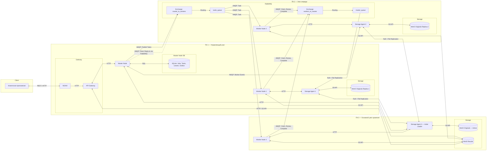
- Описание компонентов системы

Client (клиентское приложение) — предоставляет пользователю возможность загружать изображения, настраивать параметры обработки, выбирать размер сетки разбиения и просматривать итоговые изображения и отчёты.

Nginx — принимает внешние HTTP-запросы, ограничивает размер загружаемых файлов и выполняет первичную фильтрацию запросов перед передачей в API Gateway.

API Gateway — проверяет корректность входных данных, маршрутизирует запросы к Master Node и обеспечивает получение результатов из MinIO Results без прямого доступа клиента к хранилищу.

Master Node (управляющий узел) — координирует выполнение заданий. Создаёт Job и Task, определяет координаты фрагментов изображения, контролирует состояния задач и последовательность этапов обработки. Выдает воркер узлам fencing tokens и разрешения на выполнение (lease), проверяет их актуальность и организует повторное назначение задач при отказах.

Worker Nodes (вычислительные узлы) — получают задания из RabbitMQ, запрашивают разрешение на выполнение, скачивают оригиналы изображений через Storage Agents и самостоятельно выделяют фрагменты по координатам. Применяют параметры обработки, обнаруживают и классифицируют космические объекты. Также выполняют отдельные задания на объединение областей, дополнительный анализ и сборку итогового изображения. Результаты сохраняются в MinIO Results.

SQLite — хранит идентификаторы изображений, параметры обработки, состояния Job и Task, сведения о попытках выполнения, fencing tokens, сроки действия lease, пути к результатам и записи Transactional Outbox. Master Node является единственным компонентом, изменяющим состояния задач в базе данных.

RabbitMQ (Message Broker) — обеспечивает асинхронную передачу заданий и служебных сообщений между Master Node и Worker-узлами. Для двустороннего взаимодействия используются два Exchange:

1) "master_to_workers" — передача заданий, разрешений на выполнение и ответов на продление lease.
2) "workers_to_master" — передача запросов на выполнение, продление lease, сообщений о завершении и ошибках.

tasks_queue — общая очередь заданий, из которой доступные Workers получают сообщения по модели Competing Consumers. Используется ограничение "prefetch_count=1" и ручное подтверждение сообщений (ACK).

master_queue — очередь служебных сообщений от Worker-узлов к Master Node.

Direct Reply to — механизм RabbitMQ для передачи адресных ответов Master Node конкретному Worker Node. Используется для выдачи fencing tokens, подтверждения продления lease и отклонения устаревших попыток обработки изображения. При ситуации, когда сообщение теряется, воркер узел повторно отправляет запрорс с тем же идентификатором, а Master Node проверяет состояние задачи и разрешения данного воркера в SQLite.

Storage Agents — управляют доступом к репликам исходных изображений и их синхронизацией. Участвуют в выборе лидера с использованием Raft, организации репликации и восстановлении отставших копий.

MinIO Originals — объектное хранилище исходных изображений. Оригиналы не изменяются при повторном анализе с другими параметрами. Предусмотрены три экземпляра на разных физических компьютерах.

MinIO Results — отдельное объектное хранилище обработанных фрагментов, сведений об обнаруженных объектах, итоговых изображений и отчётов формата "report.json".

- Распределение по физическим узлам

ПК 1 — Управляющий узел: NGINX, API Gateway, Master Node, SQLite, Worker Node 1, Storage Agent 1, MinIO Originals Replica 1.
ПК 2 — Узел очереди: RabbitMQ, Worker Node 2, Storage Agent 2, MinIO Originals Replica 2.
ПК 3 — Основной узел хранения: Worker Node 3, Storage Agent 3, MinIO Originals Active, MinIO Results.

Обмен заданиями и служебными сообщениями между Master Node и Worker Nodes осуществляется исключительно через RabbitMQ. Worker-узлы не распределяют задания между собой напрямую.

---

## Технические сценарии

- Алгоритм обработки изображений

Обработка изображений выполняется распределённо между Worker-узлами без использования нейронных сетей. Система предназначена для обнаружения и предварительной классификации четырёх типов космических объектов: комет, планет, галактик и звёздных полей.

1.  Разделение изображения на фрагменты

Master Node получает размеры исходного изображения и определяет координаты фрагментов в соответствии с выбранной пользователем сеткой (от 1×1 до 10×10). Исходное изображение физически не разрезается и сохраняется без изменений. Для каждого фрагмента создаётся отдельное задание "PROCESS_CHUNK", которое передаётся Worker-узлам через RabbitMQ.

2. Предварительная обработка

Worker получает оригинал изображения из MinIO Originals, выделяет заданный фрагмент и применяет пользовательские параметры: яркость, контрастность, шумоподавление и масштабирование. Для поиска объектов формируется изображение в оттенках серого, к которому применяется автоматическая пороговая обработка методом Оцу.

3. Обнаружение и классификация объектов

Worker выделяет контуры потенциальных объектов с помощью OpenCV и анализирует их площадь, форму, вытянутость и яркость. На основании полученных признаков выполняется предварительная классификация:

    a. Кометы — объекты с выраженной вытянутой структурой или хвостом.
    b. Планеты — преимущественно округлые объекты с различимыми границами.
    c. Галактики — протяжённые области со сложной структурой и распределением яркости.
    d. Звёздные поля — области с большим количеством близко расположенных ярких точек.

Области, для которых невозможно определить тип объекта по доступным признакам, помечаются как неопределённые.

4. Обработка границ фрагментов

Для каждого обнаруженного объекта Worker сохраняет координаты относительно исходного изображения и информацию о его расположении вблизи границ фрагмента. После завершения обработки всех фрагментов Master Node создаёт задание "MERGE_REGIONS". Свободный Worker сопоставляет результаты соседних фрагментов и объединяет области, которые предположительно относятся к одному объекту.

5. Дополнительный анализ крупных областей

Если обнаруженные области пересекают границы фрагментов или их первоначальная классификация недостаточно определённа, Master Node создаёт задания "CLASSIFY_REGION". Worker получает соответствующую увеличенную область исходного изображения и повторно выполняет предварительную обработку, обнаружение и классификацию объектов. Это позволяет анализировать крупные объекты целиком, а не только их отдельные части.

6. Формирование итогового результата

После завершения анализа Master Node создаёт задание "ASSEMBLE_IMAGE". Свободный Worker собирает обработанные фрагменты в единое изображение, устраняет дублирование перекрывающихся областей и наносит рамки обнаруженных объектов. Для каждого объекта формируется запись в текстовом отчёте с указанием его предполагаемого типа и координат. Итоговое изображение и "report.json" сохраняются в MinIO Results. 

Если объекты не обнаружены, система формирует результат без рамок и добавляет соответствующее сообщение в отчёт.

**Результаты классификации имеют развлекательный характер и не предназначены для научного определения космических объектов.**

- Структура и состояния заданий

В системе используются три сущности:

1) Job — общее задание на обработку изображения с выбранными параметрами. Содержит "job_id", "image_id", параметры обработки и статус общей задачи.
2) Task — отдельная операция в рамках Job. Содержит "task_id", "job_id", тип операции, координаты обрабатываемой области и статус задачи обработки конкретного объекта.
3) Attempt — попытка выполнения Task конкретным Worker. Содержит идентификатор Worker, fencing token и срок действия разрешения (lease).

Типы Task:

1) "PROCESS_CHUNK" — обработка фрагмента изображения.
2) "MERGE_REGIONS" — объединение областей на границах фрагментов.
3) "CLASSIFY_REGION" — дополнительный анализ крупных областей.
4) "ASSEMBLE_IMAGE" — сборка итогового изображения и отчёта.

Состояния Job:

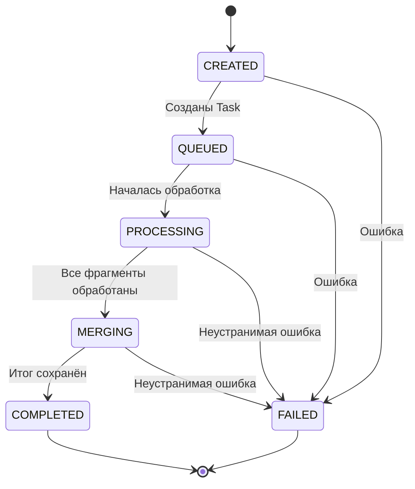

Состояния Task:

Все изменения состояний фиксируются Master Node в SQLite.

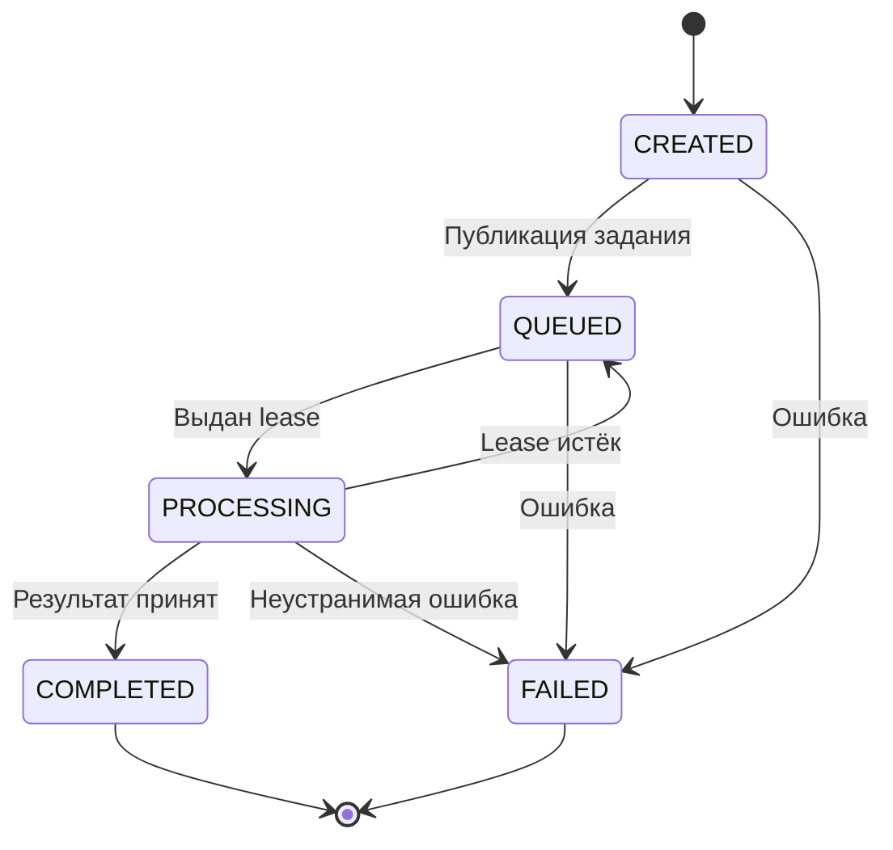

Сценарий 1: Загрузка исходного изображения

1. Пользователь выбирает изображение, получает локальное превью и отправляет файл через NGINX на API Gateway.
2. NGINX проверяет ограничения запроса, API Gateway проверяет формат JPEG/PNG и корректность файла.
3. Master Node генерирует "image_id" и создаёт запись об изображении в SQLite.
4. Master Node передаёт файл активному Storage Agent, который сохраняет оригинал в MinIO Originals и организует репликацию.
5. После подтверждения сохранения Master Node фиксирует результат в SQLite и возвращает клиенту "image_id".

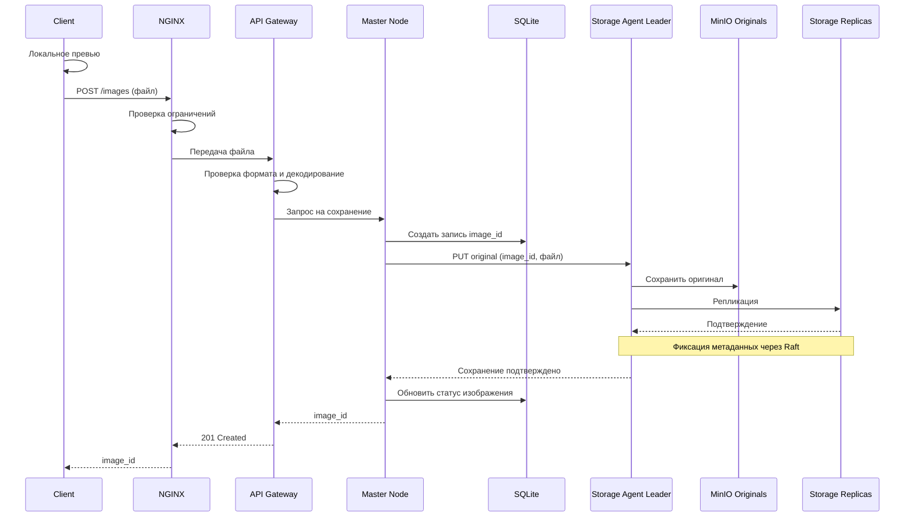
Сценарий 2: Настройка параметров и запуск анализа

1. Пользователь отправляет "image_id", параметры обработки и размер сетки через NGINX и API Gateway.
2. Master Node создаёт Job, определяет координаты фрагментов и сохраняет отдельные Task типа "PROCESS_CHUNK" вместе с записями Transactional Outbox в SQLite.
3. Outbox Publisher публикует задания через Exchange "master_to_workers". RabbitMQ распределяет их между свободными Workers из общей очереди "tasks_queue".
4. Worker запрашивает через Exchange "workers_to_master" разрешение на выполнение. Master Node выдаёт fencing token и lease, сохраняя их в SQLite. Ответ поступает через Direct Reply-to.
5. Worker скачивает оригинал через Storage Agent, выделяет фрагмент по координатам, применяет параметры обработки и обнаруживает космические объекты, периодически продлевая lease.
6. Worker сохраняет фрагмент и сведения об объектах в MinIO Results, публикует "TASK_COMPLETED" и после Publisher Confirm отправляет ACK исходного задания.
7. Master Node проверяет актуальность fencing token, фиксирует результат в SQLite и подтверждает обработку сообщения о завершении.
8. После обработки всех фрагментов Master Node переводит Job в "MERGING" и через Transactional Outbox создаёт задачи "MERGE_REGIONS" и, при необходимости, "CLASSIFY_REGION". Workers объединяют области на границах и дополнительно анализируют крупные объекты.
9. Master Node создаёт через Transactional Outbox задачу "ASSEMBLE_IMAGE". Свободный Worker собирает итоговое изображение, наносит рамки и сохраняет его вместе с "report.json" в MinIO Results.
10. После подтверждения завершения сборки Master Node сохраняет пути к результатам в SQLite и переводит Job в "COMPLETED".

Для всех типов Task используются одинаковые механизмы выдачи разрешений, продления lease, подтверждения выполнения и повторной доставки.

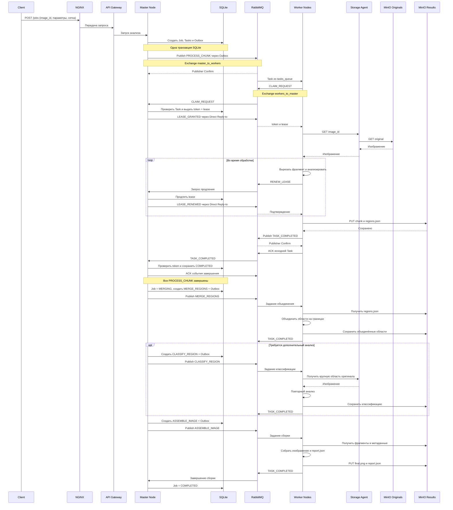

Сценарий 3: Получение и просмотр результата

1. Клиент периодически запрашивает статус Job через NGINX и API Gateway.
2. Master Node проверяет состояние Job в SQLite.
3. Если обработка продолжается, клиент получает текущий статус.
4. Если Job завершён, API Gateway получает итоговое изображение и отчёт из MinIO Results и передаёт их пользователю.
5. Пользователь просматривает изображение с выделенными объектами и текстовый отчёт.

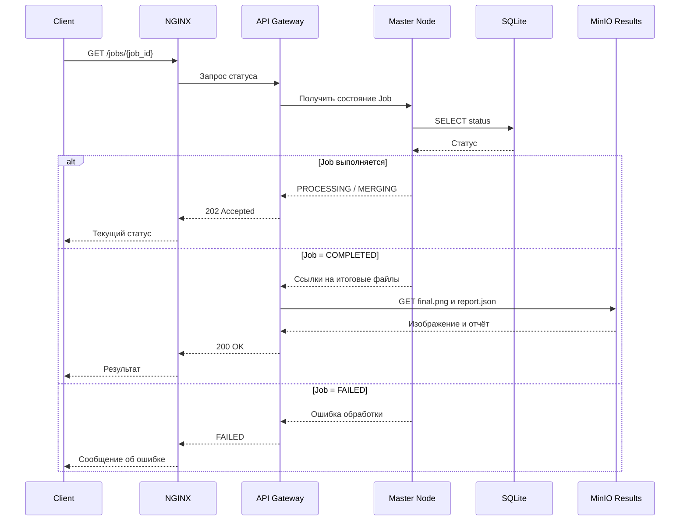
Сценарий 4.1: Неподдерживаемый формат файла

1. Пользователь отправляет файл неподдерживаемого формата.
2. NGINX проверяет ограничения запроса, API Gateway проверяет формат файла.
3. API Gateway возвращает ошибку "415 Unsupported Media Type".
4. Изображение не сохраняется, задание обработки не создаётся.
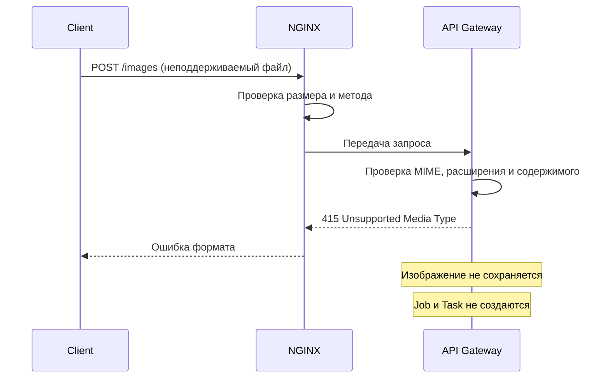
Сценарий 4.2: Повреждённый файл

1. Пользователь отправляет повреждённое изображение JPEG или PNG.
2. API Gateway пытается декодировать изображение и обнаруживает ошибку.
3. Пользователю возвращается "422 Unprocessable Entity".
4. Изображение не сохраняется, задание обработки не создаётся.
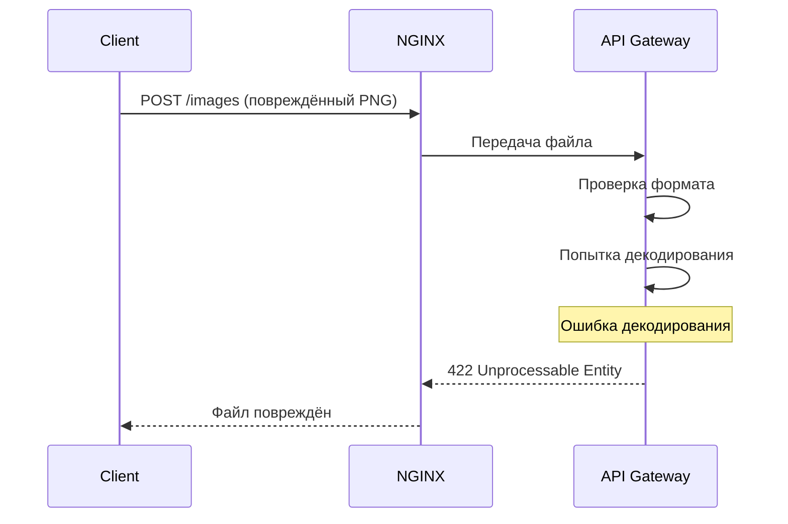
Сценарий 5: Космические объекты не обнаружены

1. Пользователь запускает анализ по сценарию 2.
2. Workers обрабатывают фрагменты, но не обнаруживают объектов, соответствующих заданным критериям.
3. Worker собирает итоговое изображение без рамок и формирует отчёт с сообщением об отсутствии обнаруженных объектов.
4. Master Node переводит Job в "COMPLETED".
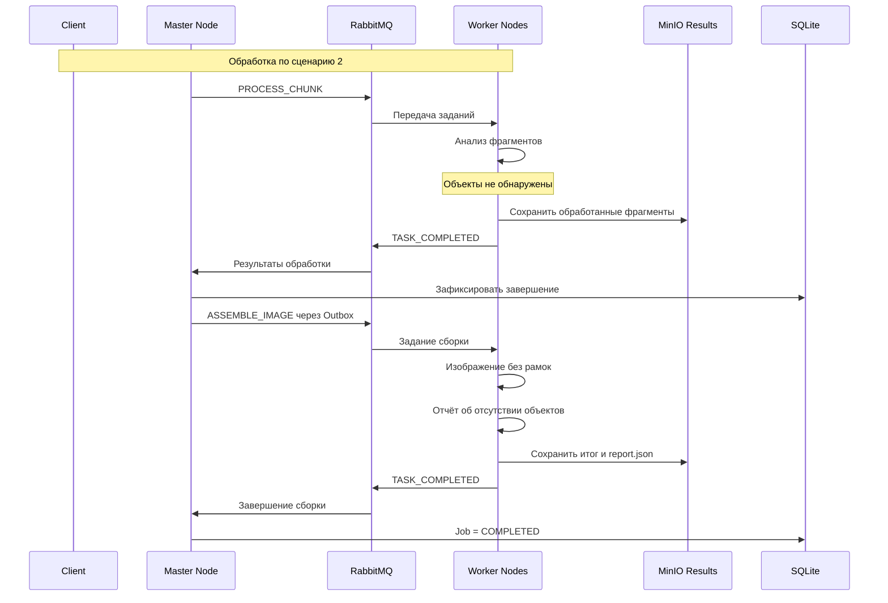
Сценарий 6: Отказоустойчивость вычислений (отказ или зависание Worker)

1. Worker получает Task, fencing token и lease, после чего начинает обработку.
2. Worker аварийно завершается или зависает и перестаёт продлевать lease.
3. При разрыве соединения RabbitMQ возвращает неподтверждённое сообщение в очередь. При истечении lease Master Node признаёт попытку недействительной и при необходимости повторно публикует Task через Outbox.
4. Другой Worker получает задание и новый fencing token с lease.
5. Если прежний Worker возобновит работу, его результат будет отклонён из-за устаревшего токена.
6. После успешного выполнения Master Node принимает результат актуальной попытки и фиксирует завершение Task в SQLite.
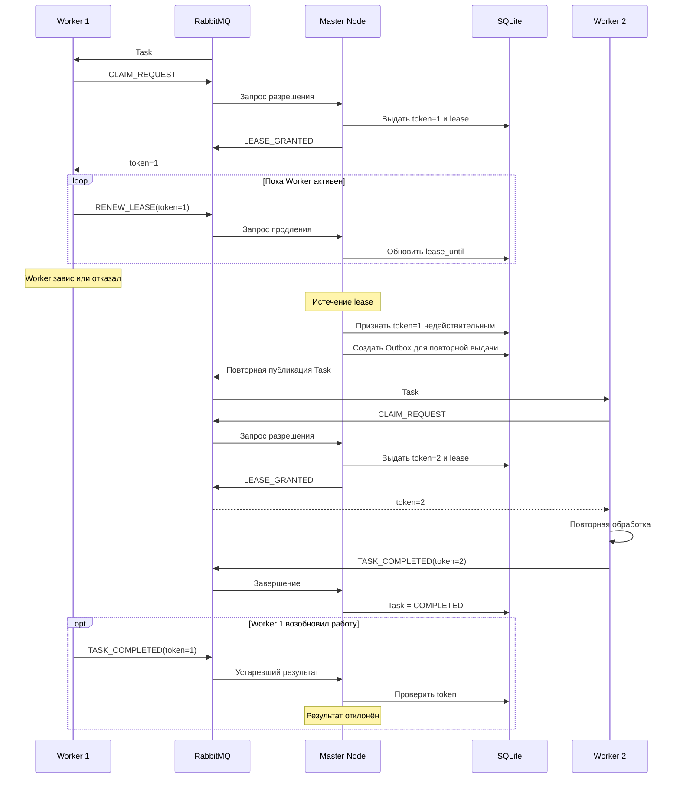

Сценарий 7: Отказоустойчивость хранилища (отказ Storage Leader)

1. Компьютер с активным Storage Agent и MinIO Originals становится недоступен.
2. Оставшиеся Storage Agents обнаруживают отказ и выбирают нового лидера посредством Raft.
3. Master Node перенаправляет запросы на нового Storage Leader.
4. Ранее подтверждённые оригиналы остаются доступны через реплики при соблюдении гарантий репликации.
5. Если отказал ПК 3, MinIO Results также недоступен, поэтому сохранение и получение результатов приостанавливаются до его восстановления.
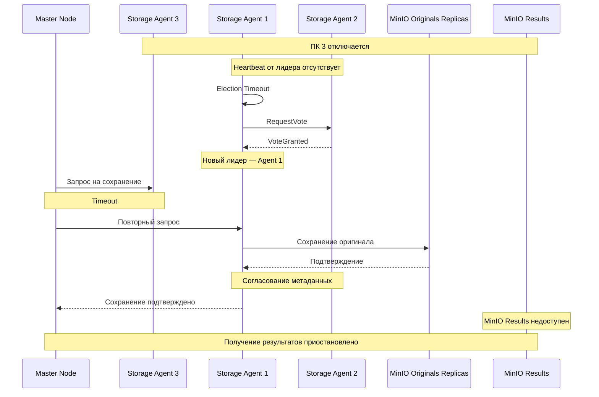
Сценарий 8: Недоступность MinIO Results

1. Worker завершает обработку, но не может сохранить результат в MinIO Results.
2. Worker повторяет попытки сохранения, продолжая продлевать lease, и не отправляет "TASK_COMPLETED" до успешной записи.
3. Если хранилище остаётся недоступным, текущая попытка прекращается. Master Node после истечения lease организует повторное назначение Task.
4. После восстановления MinIO Results доступный Worker повторно выполняет незавершённую задачу.
5. Master Node фиксирует результат в SQLite после успешного сохранения и подтверждения завершения..
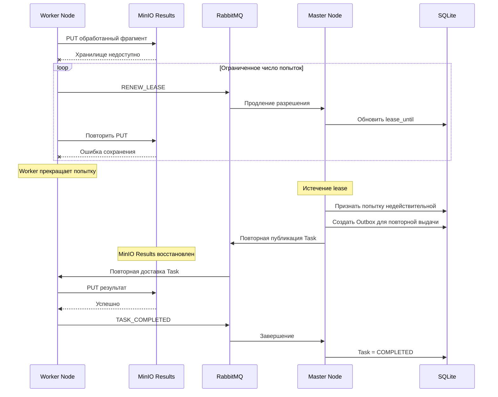
---

## План разработки и тестирования
План разработки и тестирования

Включает:

- Реализацию клиентского приложения для загрузки изображений, настройки параметров обработки и просмотра результатов.
- Реализацию NGINX и API Gateway для маршрутизации запросов и проверки входных данных.
- Реализацию Master Node для управления заданиями, их состояниями и распределением обработки через RabbitMQ.
- Реализацию Worker-узлов для параллельной обработки фрагментов изображений, обнаружения космических объектов и формирования результатов.
- Интеграцию SQLite для хранения состояний заданий и реализацию Transactional Outbox.
- Реализацию повторной доставки заданий (at-least-once), обнаружения отказов Worker-узлов и идемпотентности обработки.
- Реализацию репликации MinIO Originals с использованием Storage Agents, алгоритма Raft и автоматического переключения лидера.
- Интеграцию MinIO Results для хранения обработанных изображений и текстовых отчётов.

План разработки

- Проектирование API для загрузки изображений, запуска обработки, получения статусов и результатов.
- Реализация NGINX и API Gateway (маршрутизация запросов, ограничение размера файлов, валидация входных данных).
- Реализация клиентского приложения (загрузка изображений, превью, настройка параметров и просмотр результатов).
- Реализация Master Node и интеграция SQLite (создание заданий, FSM состояний, определение координат фрагментов).
- Интеграция RabbitMQ и реализация Transactional Outbox для надёжной публикации заданий.
- Реализация Worker-узлов (получение заданий, выделение фрагментов, применение параметров обработки, поиск космических объектов).
- Реализация объединения областей на границах фрагментов, дополнительного анализа крупных объектов и сборки итогового изображения.
- Интеграция MinIO Results для хранения промежуточных результатов, итоговых изображений и отчётов.
- Реализация механизма at-least-once доставки заданий, ручных ACK, идемпотентности и повторного назначения задач при отказах Worker-узлов.
- Реализация Storage Agents и репликации исходных изображений между тремя MinIO Originals.
- Реализация алгоритма Raft для выбора лидера, согласования метаданных и автоматического переключения на доступную реплику.
- Реализация восстановления отказавших реплик Originals и синхронизации недостающих изображений.
- Интеграция всех компонентов на трёх физических компьютерах.

План тестирования

- Модульные тесты алгоритмов обработки изображений, выделения фрагментов, объединения областей и классификации объектов.
- Модульные тесты FSM: проверка допустимых и недопустимых переходов состояний заданий.
- Тесты API Gateway и NGINX (корректные запросы, неподдерживаемые форматы, повреждённые изображения, превышение размера файла).
- Интеграционные тесты взаимодействия Master Node, SQLite, RabbitMQ и Worker-узлов.
- Тест Transactional Outbox: сбой публикации сообщения после записи задания в SQLite с последующей успешной отправкой.
- Тест at-least-once: повторная доставка неподтверждённого задания после отказа Worker.
- Тест идемпотентности: повторное выполнение задания не приводит к дублированию результатов.
- Тест обнаружения отказов: прекращение продления lease Worker, истечение срока разрешения и повторное назначение незавершённой задачи.
- Тест параллельности: фрагменты одного изображения одновременно обрабатываются несколькими Worker-узлами.
- Тест репликации Originals: исходное изображение сохраняется минимум на двух независимых узлах.
- Тест failover: отключение текущего Storage Leader, выбор нового лидера и продолжение записи оригиналов.
- Тест восстановления реплики: после возвращения отказавшего узла выполняется синхронизация недостающих изображений.
- Тест согласованности: ранее подтверждённые изображения остаются доступными после смены лидера.
- Тест обработки изображений без обнаруженных объектов и повреждённых файлов.
- Нагрузочное тестирование при одновременной загрузке и обработке изображений несколькими пользователями.
- Проверка ограничений отказоустойчивости при недоступности SQLite, RabbitMQ и MinIO Results.

Definition of Done (DoD)

- Пользователь может загрузить изображение JPEG или PNG, настроить параметры обработки и получить результат.
- При разбиении изображения на несколько независимых фрагментов система обеспечивает их параллельную обработку доступными Worker-узлами.
- Объекты на границах фрагментов корректно объединяются, итоговое изображение и текстовый отчёт формируются.
- При отказе Worker незавершённая задача повторно доставляется другому доступному Worker.
- Повторная обработка задания не приводит к дублированию результатов.
- При отказе Storage Leader автоматически выбирается новый лидер, ранее подтверждённые оригиналы остаются доступными.
- После восстановления отказавший узел синхронизирует недостающие изображения.
- Некорректные файлы и случаи отсутствия обнаруженных объектов обрабатываются согласно техническим сценариям.
- Все компоненты запускаются на трёх физических компьютерах и взаимодействуют по локальной сети.
