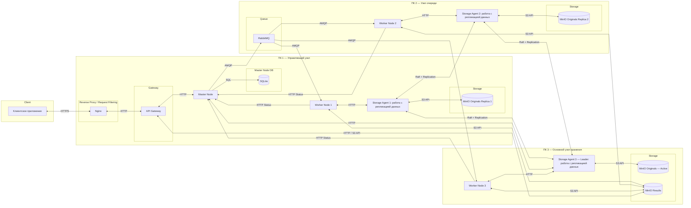
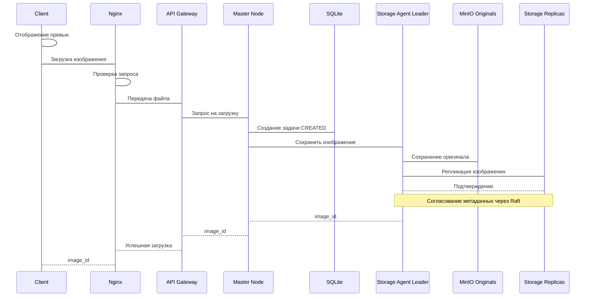
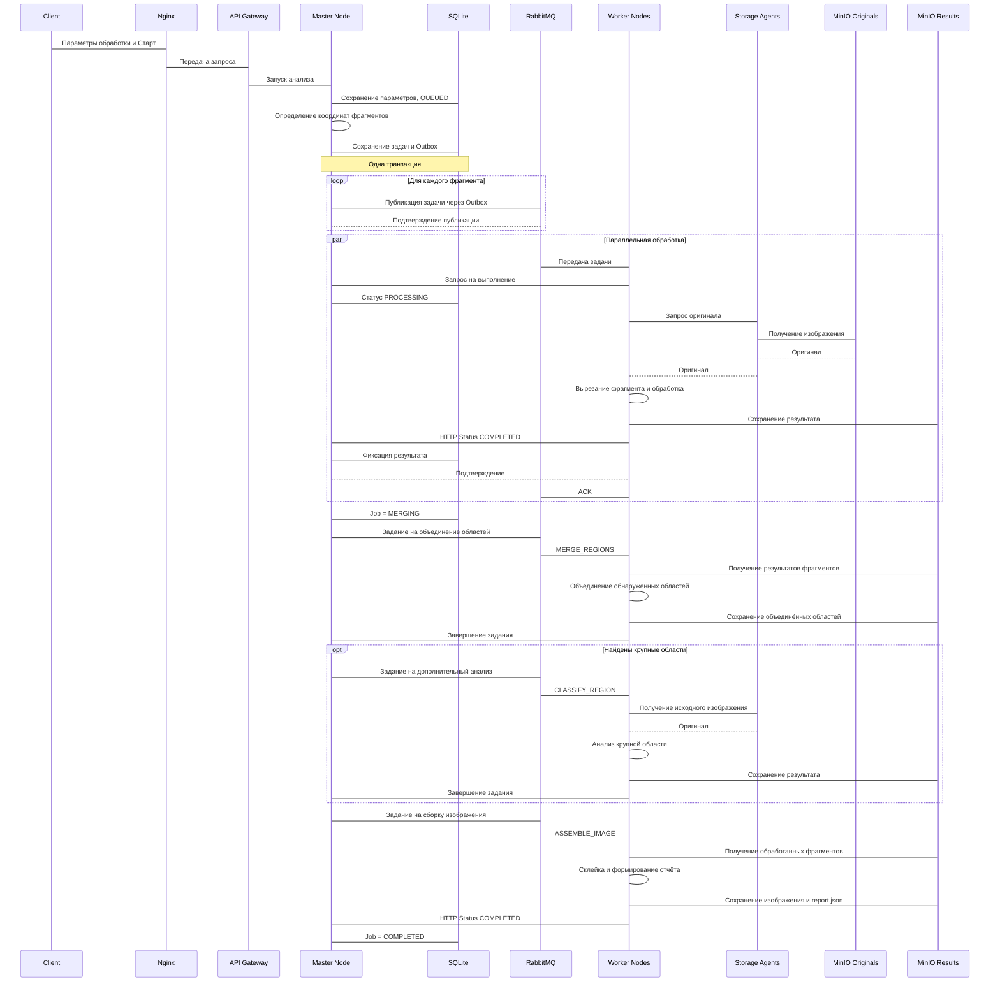
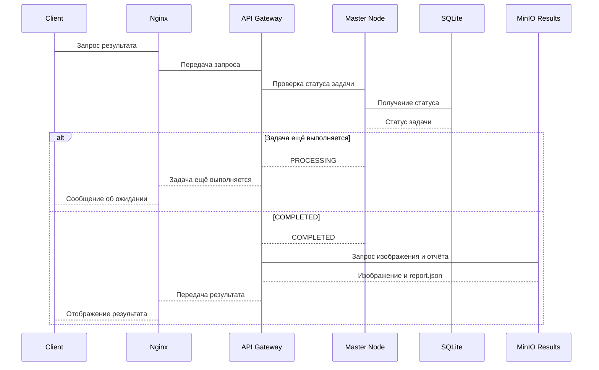
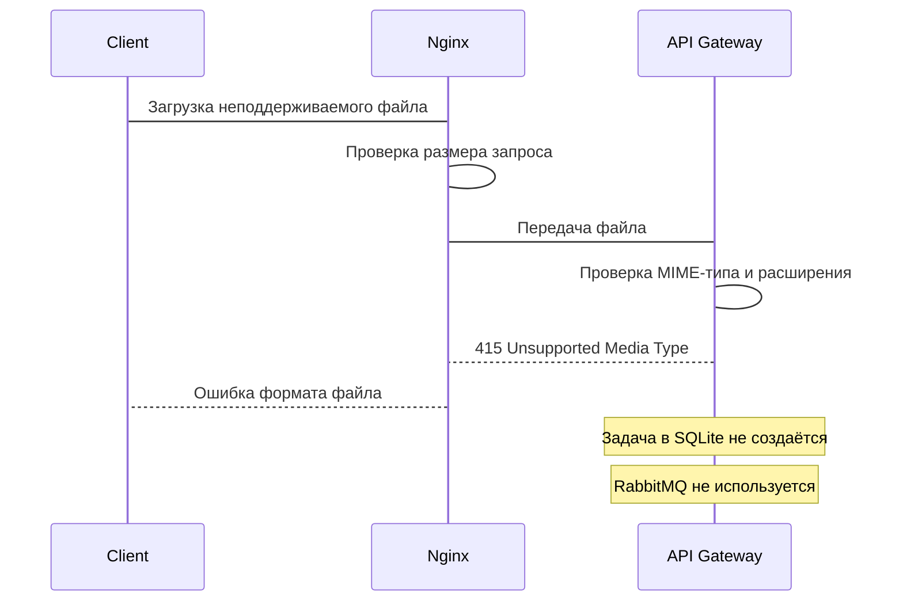
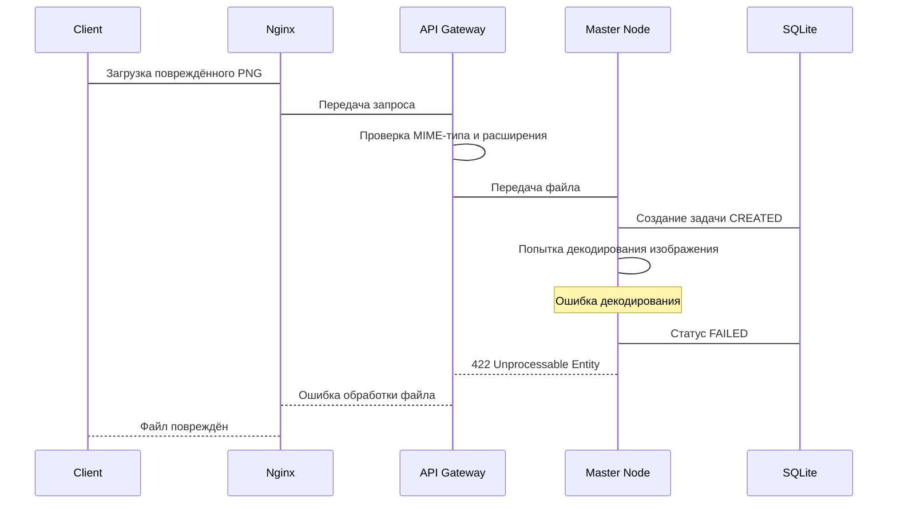
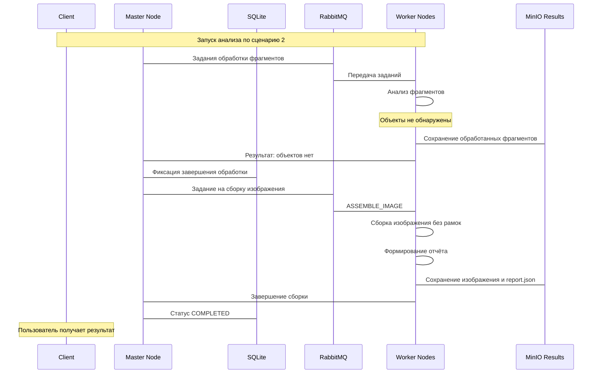
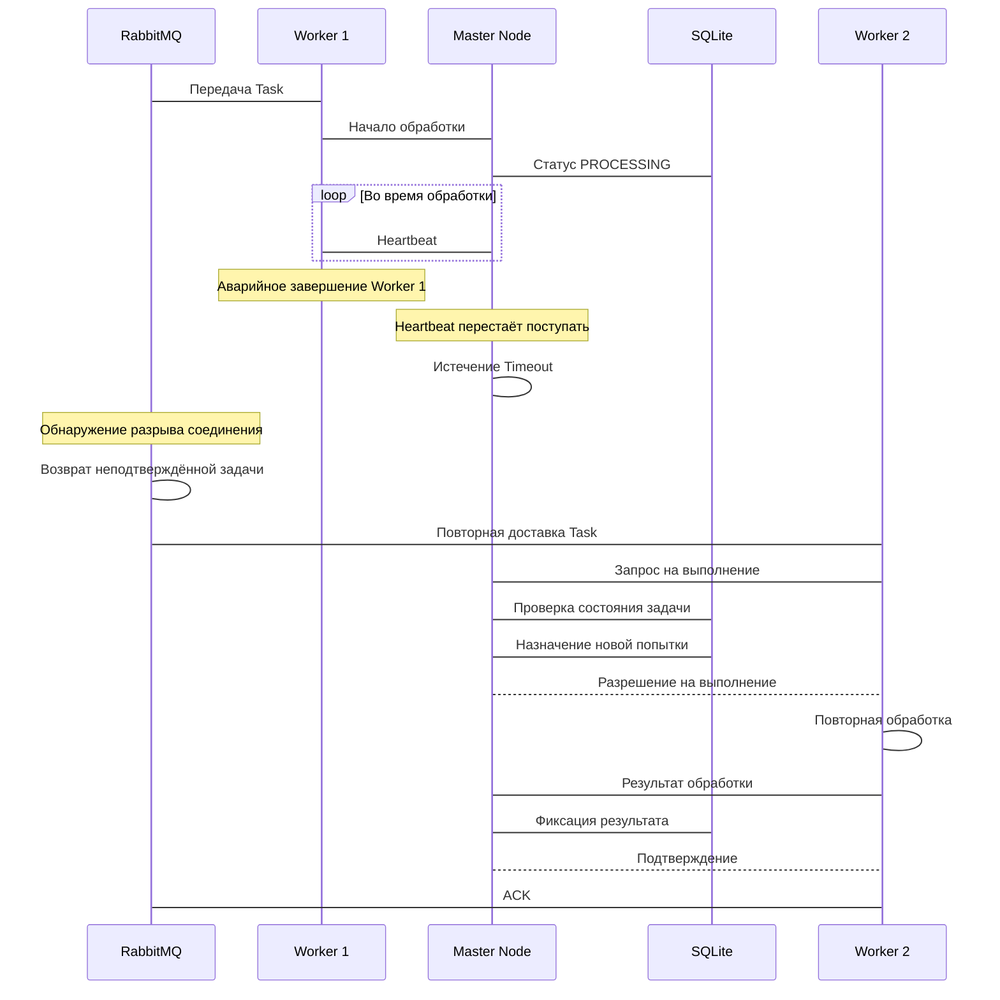
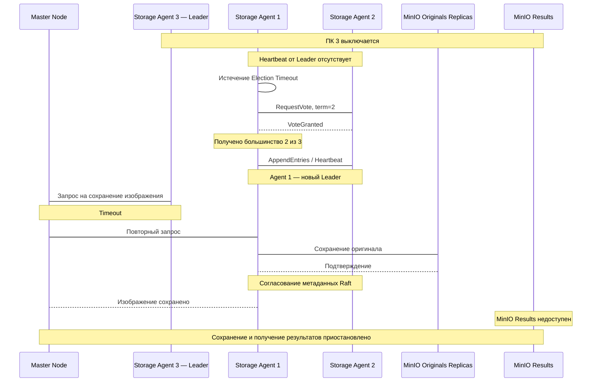

# Техническое решение проекта «Лазарь»

## Введение
«Лазарь» — программа обработки изображений с распределённой архитектурой, предназначенная для преобразования графических файлов и их анализа на наличие космических объектов. Анализ выполняется на основе характеристик яркости и геометрической формы областей на изображениях в форматах PNG и JPEG. «Лазарь» позволяет приблизительно определить кометы, планеты, галактики и звездные поля; в случае, если визуальных признаков не достаточно для определениия типа объекта, система относит его к категории неопределенных объектов. 
По окончании анализа пользователь получит обработанное изображение с выделенными и подписанными обнаруженными космическими объектамаи, а также текстовый отчет с предполагаемыми типами объектов и их характеристиками.

- **Цель проекта:**  
  Реализовать прототип распределённой системы, позволяющей пользователям загружать изображения для их автоматического анализа на распределенном вычислительном кластере.

- **Основания для разработки:**  
  1. Закрепить теоретические основы распределенных систем (маштабируемость, отказоустойчивость, консистентность) на практике
  2. Учебный проект по курсу «Распределенные системы»

- **Команда:**  

  | ФИО участника    | Роль в проекте    |
  |------------------|-------------------|
  | Богомаз Алиса    | DevOps, Team Lead |
  | Михайлов Дмитрий | System Analyst    |
  | Давыдова Дарья   | UX Designer       |

---

## Глоссарий
| Термин        | Определение |
|---------------|-------------|
| Пользователь  | Лицо, взаимодействующее с системой через приложение |
| Графический файл | Изображение |
| Приложение | Программа для настройки и анализа изображений |
| Распределенный кластер | Совокупность вычислительных узлов, совместно выполняющих обработку изображения|
|Worker-узел| Вычислительный узел системы, выполняющий непосредственную обработку и анализ фрагментов изображений|
|Идемпотентность|Свойство, при котором повторное выполнение одной задачи не меняет итоговый результат операции|
|Консистентность|Свойство, гарантирующее согласованность состояний задач и результатов обработки |
|Presigned URL|Временная ссылка, предоставляющая ограниченный доступ к объекту в хранилище без передачи учетных данных|
|S3 API|Интерфейс взаимодействия с объектным хранилищем|
|API Gateway|Компонент системы, принимающий и перенаправляющий запросы клиентов|
|Master Node|Управляющий узел, координирующий создание, распределение и выполнение задач|
|Worker Node |Вычислительный узел, выполняющий обработку назначенных фрагментов изображений|
|SQLite|База данных для хранения состояний заданий и метаданных|
|RabbitMQ|Брокер сообщений, обеспечивающий передачу заданий вычислительным узлам|
|MinIO|Объектное хранилище исходных изображений и результатов обработки|
|HTTP|Протокол передачи данных между клиентами и компонентами системы|
|AMQP|Протокол обмена сообщениями между RabbitMQ и компонентами системы|
|Heartbeat|Периодический сигнал для контроля доступности вычислительного узла|
|TImeout|Интервал ожидания, по истечении которого система предполагает сбой|
|ACK|Подтверждение обработки сообщения, отправляемого Worker брокеру RabbitMQ|
|Retry|Повторная попытка выполнения задания после ошибки или сбоя|

---

## Функциональные требования
- **Система должна предоставлять следующие функции:**
1. Загрузка исходного изображения и возможность заменить его на другое до запуска обработки
2. Отображение загруженного изображения на экран для предварительного просмотра
3. Настройка яркости, контрастности, масштаба и степени шумоподавления выбранного изображения
4. Отображение измененного пользователем изображения до запуска обработки
5. Автоматический анализ изображения с выбранными параметрами и последующим определением его содержимого: комета, планета, галактика, звездное поле или неопределенный тип объекта
6. Отображение состояния выполнения задачи
7. Возможность просмотра результатов анализа только по окончании обработки графического файла
8. Просмотр обработанного файла и результатов анализа в виде выделенных рамками и подписанных предположительными типами объектов на изображении
9. Составление текстового отчета по результатам обработки с указанием предположительных типов объектов, их количества и их параметров (яркость, геометрическая форма, координаты)
10. Возможность сохранить полученное обработанное изображение и текстовый отчет на устройство пользователя
11. Возможность изменить изображение и его параметры и повторить анализ в случае неуспешной или не возможной обработки системой файла

- **Ограничения на предметную область:**
1. Система предназначена для обработки и анализа растровых изображений космического пространства в форматах JPEG и PNG
2. Определение типов космических объектов, отличающихся от планет, комет, галактик и звездных полей не предусматривается
3. Система ориентирована на анализ изображений, содержащих один или несколько визуально различимых объектов, либо множества ярких областей, образующих звездное поле
4. Результаты анализа являются предварительными и не предназначены для научных исследований

---

## Нефункциональные требования
- **Масштабируемость:** возможность увеличивать число Worker-узлов без изменения логики
- **Отказоустойчивость:** при падении одного из Worker-узлов система должна обнаружить его недоступность и передать его задачи на выполнение в очередь для других Worker-узлов
- **Параллельность:** система должна обеспечивать параллельное выполнение независимых задач несколькими узлами
- **Консистентность:** система должна обеспечивать согласованность состояний задач и результатов обработки между узлами
- **Балансировка нагрузки:** система должна динамически распределять задачи между доступными Worker-узлами с учетом их загруженности
- **Идемпотентность:** повторное выполнение одной задачи не должно влиять на итоговый результат обработки изображения

---

## Пользовательские сценарии
Сценарий: загрузка исходного изображения
1.	Пользователь запускает приложение 
2.	Пользователь выбирает функцию загрузки изображения и загружает графический файл 
3.	Система проверяет формат файла и отображает его превью на экране

Сценарий: загрузка другого изображения
1.  Пользователь загружает другой графический файл через функцию выбора другого изображения 
2.	Система проверяет формат файла и обновляет превью, отображая на экран новое изображение

Сценарий: настройка параметров и запуск анализа
1.	Пользователь настраивает визуальные параметры для обработки фотографии: 
    1. Изменение контраста и яркости 
    2. Подавление цифрового шума на снимке 
    3. Масштабирование 
2.	Пользователь выбирает функцию запуска обработки
3.	Система подтверждает приём файла, сохраняет настройки и начинает обработку

Сценарий: получение и просмотр результата 
1.	Пользователь запрашивает результат обработки
2.	Система выводит обработанное изображение с найденными космическими объектами и текстовый отчет с результатами

Сценарий: файл поврежден или не подходит для обработки
1. Пользователь запускает приложение
2. Пользователь загружает поврежденный или неподдерживаемый для обработки файл через функцию загрузки изображения
3. Система проверяет формат файла и обнаруживает несоответствие требованиям
4. Система выводит на экран сообщение об ошибке
5. Система предоставляет пользователю возможность выбрать другой графический файл для анализа

Сценарий: космические объекты не были обнаружены
  1. Пользователь загружает изображение
  2. Система проверяет формат файла и отображает его превью на экране
  3. Пользователь настраивает визуальные параметры для обработки фотографии
  4. Пользователь выбирает функцию запуска обработки
  5.	Система подтверждает приём файла, сохраняет настройки и начинает обработку
  6. Система не обнаруживает областей, соответствующих заданным критериям обнаружения объектов
  7. Система выводит обработанное изображение на экран и текстовый отчет с сообщением "Объекты, соответствующие критериям обнаружения, не найдены", и предоставляет пользователю возможность выбрать другой файл, изменить параметры обработки исходного файла и повторно запустить анализ

---

##  Архитектура системы

---

## Технические сценарии

Сценарий 1: Загрузка исходного изображения
1. Пользователь отправляет файл через клиентское приложение в Nginx.
2. Nginx проверяет формат запроса и отправляет его в API Gateway.
3. API Gateway передает запрос в Master Node , она создает запись о задаче в базе данных (SQLite) со статусом CREATED.
4. Storage Agent (Leader) получает запрос на сохранение изображениие от Master Node, сохраняет оригинал изображения в MinIO Originals и организует его репликацию на другие узлы. После подтверждения сохранения возвращает Master Node идентификатор изображения.
5. Master Node передает идентификатор изображения клиенту через API Gateway и Nginx
5. Пользователь получает превью загруженного изображения.

Сценарий 2: Настройка параметров и запуск анализа
1. Пользователь отправляет параметры (яркость, контраст, шум, масштаб) и команду о начале обработки Nginx.
2. Nginx обрабатывает запрос и передает его API Gateway
3. API Gateway отправляет запрос в Master Node, она сохраняет параметры в БД, меняет статус задачи на QUEUED.
4. Master Node определяет координаты фрагментов исходного изображения, не изменяя сам файл. Используя паттерн Transactional Outbox, он сначала фиксирует сообщения в БД, а затем публикует задачу в RabbitMQ.
5. Worker-узлы (W1, W2, W3) вычитывают задачи из RabbitMQ. Каждый воркер берет свою уникальную задачу, статус задачи меняется на PROCESSING.
6. Воркеры скачивают оригинал изображения из MinIO (через Storage Agents), вырезают из него заданную область, применяют фильтры и запускают алгоритмы поиска космических объектов.
7. Результаты обработки сохраняются в MinIO Results. Воркеры отправляют HTTP Status с отчетом о завершении Мастеру.
8. Master Node получает отчеты от всех воркеров, меняет статус на MERGING, создает задачу на склеивание обработанных областей и на дополнительный анализ объединенной области на обнаружение крупных фрагментов, и отправляет ее в RabbitMQ
9. Свободные воркер узлы выполняют новые задачи и отправляют результат с текстовым отчетом в MinIO Results.
10. Master Node получает ссылки на обработанное изображение и на текстовый отчет и меняет статус на COMPLETED.

Сценарий 3: Получение и просмотр результата
1. Пользователь получает уведомление о завершении обработки и может запросить итоговое изображение и текстовый отчет через API Gateway
2. API Gateway обращается к Master Node для проверки статуса задачи в БД. Если статус ниже COMPLETED — возвращается ошибка «Задача еще выполняется».
3. Если статус COMPLETED, система получает готовое изображение и текстовый отчет из MinIO Results.
4. Пользователь видит изображение с выделенными рамками объектов и отчет.

Сценарий 4.1: Неподдерживаемый формат файла (Ошибка валидации)
1. Пользователь загружает файл .exe, .txt или видео.
2. Nginx выполняет проверку запроса и ограничение размера файла, передает запрос в API Gateway, API Gateway проверяет MIME-тип и расширение.
3. API Gateway отклоняет запрос с ошибкой 400 Bad Request (или 415 Unsupported Media Type).
4. Задача в БД не создается, в RabbitMQ ничего не уходит.

Сценарий 4.2: Поврежденный файл (Ошибка декодирования)
1. Пользователь загружает файл image.png с правильным расширением, но с битыми байтами внутри.
2. Запрос проходит через Nginx, API Gateway пропускает его (формат верный) и передает в Master Node.
3. Master Node пытается декодировать изображение. Возникает исключение (файл не читается).
4. Master Node помечает задачу в БД как FAILED. Пользователю возвращается ошибка 422 Unprocessable Entity. Задача в RabbitMQ не уходит.

Сценарий 5: Космические объекты не были обнаружены
1. Выполняются все шаги Сценария 2 (задача в работе).
2. Воркеры обрабатывают кропы, но алгоритм не находит объектов, соответствующих заданным пороговым значениям яркости и формы.
3. В текстовом отчете формируется запись: «Объекты, соответствующие критериям обнаружения, не найдены».
4. Пользователь видит исходное (отфильтрованное) изображение и отчет с сообщением об отсутствии объектов.

Сценарий 6: Отказоустойчивость вычислений (Падение Worker-узла)
1. Worker Node берет задачу в работу, но внезапно падает (процесс убит).
2. Master Node перестает получать от него Heartbeat (периодические HTTP-сигналы о статусе).
3. По истечении Timeout (таймаута) RabbitMQ обнаруживает разрыв соединения и возвращает неподтвержденную задачу в очередь
4. Другой живой Worker Node забирает задачу. Master Node проверяет состояние задачи в БД и разрешает новую попытку выполнения. Новый воркер обрабатывает полученный фрагмент как обычно.

Сценарий 7: Отказоустойчивость хранилища (Падение Leader)
1. ПК, где находится Storage Agent — Leader и активный MinIO Originals (и MinIO Results) выключаются.
2. Storage Agents на двух других ПК теряют связь с Лидером. Запускается протокол Raft, один из оставшихся агентов становится новым Лидером.
3. Master Node пытается сохранить файл через старого Лидера, получает таймаут и перенаправляет запрос к новому Лидеру.
4. Система продолжает работу, данные не теряются благодаря механизму репликации. Однако система не имеет возможности сохранять результаты обработки и получать ранее загруженные обработанные изображения из-за падения MinIO Results, и должна дождаться их восстановления для передачи результатов.

---

## План разработки и тестирования
План разработки и тестирования

Включает:

- Реализацию клиентского приложения для загрузки изображений, настройки параметров обработки и просмотра результатов.
- Реализацию NGINX и API Gateway для маршрутизации запросов и проверки входных данных.
- Реализацию Master Node для управления заданиями, их состояниями и распределением обработки через RabbitMQ.
- Реализацию Worker-узлов для параллельной обработки фрагментов изображений, обнаружения космических объектов и формирования результатов.
- Интеграцию SQLite для хранения состояний заданий и реализацию Transactional Outbox.
- Реализацию повторной доставки заданий (at-least-once), обнаружения отказов Worker-узлов и идемпотентности обработки.
- Реализацию репликации MinIO Originals с использованием Storage Agents, алгоритма Raft и автоматического переключения лидера.
- Интеграцию MinIO Results для хранения обработанных изображений и текстовых отчётов.

План разработки

- Проектирование API для загрузки изображений, запуска обработки, получения статусов и результатов.
- Реализация NGINX и API Gateway (маршрутизация запросов, ограничение размера файлов, валидация входных данных).
- Реализация клиентского приложения (загрузка изображений, превью, настройка параметров и просмотр результатов).
- Реализация Master Node и интеграция SQLite (создание заданий, FSM состояний, определение координат фрагментов).
- Интеграция RabbitMQ и реализация Transactional Outbox для надёжной публикации заданий.
-  Реализация Worker-узлов (получение заданий, выделение фрагментов, применение параметров обработки, поиск космических объектов).
- Реализация объединения областей на границах фрагментов, дополнительного анализа крупных объектов и сборки итогового изображения.
- Интеграция MinIO Results для хранения промежуточных результатов, итоговых изображений и отчётов.
- Реализация механизма at-least-once доставки заданий, ручных ACK, идемпотентности и повторного назначения задач при отказах Worker-узлов.
- Реализация Storage Agents и репликации исходных изображений между тремя MinIO Originals.
- Реализация алгоритма Raft для выбора лидера, согласования метаданных и автоматического переключения на доступную реплику.
- Реализация восстановления отказавших реплик Originals и синхронизации недостающих изображений.
- Интеграция всех компонентов на трёх физических компьютерах.

План тестирования

- Модульные тесты алгоритмов обработки изображений, выделения фрагментов, объединения областей и классификации объектов.
- Модульные тесты FSM: проверка допустимых и недопустимых переходов состояний заданий.
- Тесты API Gateway и NGINX (корректные запросы, неподдерживаемые форматы, повреждённые изображения, превышение размера файла).
- Интеграционные тесты взаимодействия Master Node, SQLite, RabbitMQ и Worker-узлов.
- Тест Transactional Outbox: сбой публикации сообщения после записи задания в SQLite с последующей успешной отправкой.
- Тест at-least-once: повторная доставка неподтверждённого задания после отказа Worker.
- Тест идемпотентности: повторное выполнение задания не приводит к дублированию результатов.
- Тест обнаружения отказов: прекращение Heartbeat Worker и повторное назначение незавершённой задачи.
- Тест параллельности: фрагменты одного изображения одновременно обрабатываются несколькими Worker-узлами.
- Тест репликации Originals: исходное изображение сохраняется минимум на двух независимых узлах.
- Тест failover: отключение текущего Storage Leader, выбор нового лидера и продолжение записи оригиналов.
- Тест восстановления реплики: после возвращения отказавшего узла выполняется синхронизация недостающих изображений.
- Тест согласованности: ранее подтверждённые изображения остаются доступными после смены лидера.
- Тест обработки изображений без обнаруженных объектов и повреждённых файлов.
- Нагрузочное тестирование при одновременной загрузке и обработке изображений несколькими пользователями.
- Проверка ограничений отказоустойчивости при недоступности SQLite, RabbitMQ и MinIO Results.

Definition of Done (DoD)

- Пользователь может загрузить изображение JPEG или PNG, настроить параметры обработки и получить результат.
- Одно изображение разбивается на фрагменты, которые параллельно обрабатываются минимум тремя Worker-узлами.
- Объекты на границах фрагментов корректно объединяются, итоговое изображение и текстовый отчёт формируются.
- При отказе Worker незавершённая задача повторно доставляется другому доступному Worker.
- Повторная обработка задания не приводит к дублированию результатов.
- При отказе Storage Leader автоматически выбирается новый лидер, ранее подтверждённые оригиналы остаются доступными.
- После восстановления отказавший узел синхронизирует недостающие изображения.
- Некорректные файлы и случаи отсутствия обнаруженных объектов обрабатываются согласно техническим сценариям.
- Все компоненты запускаются на трёх физических компьютерах и взаимодействуют по локальной сети.
